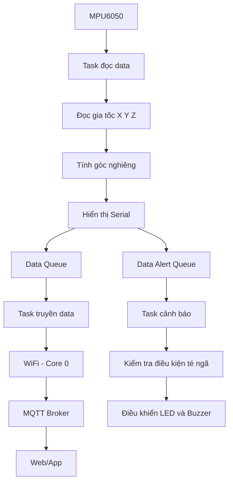

# 🚨 HỆ THỐNG PHÁT HIỆN TÉ NGÃ – FALL DETECTION SYSTEM
### ESP32 | MPU6050 | FreeRTOS | MQTT | Wokwi | Web/App

## 1. Giới thiệu đề tài

Dự án xây dựng hệ thống phát hiện té ngã ở người bằng cách sử dụng vi điều khiển **ESP32** kết hợp với cảm biến gia tốc và con quay hồi chuyển **MPU6050**.

Hệ thống thực hiện đo gia tốc theo ba trục X, Y, Z và góc nghiêng của cơ thể. Khi phát hiện sự thay đổi đột ngột của gia tốc hoặc góc nghiêng vượt ngưỡng cài đặt, hệ thống sẽ đưa ra cảnh báo thông qua còi và đèn LED.

Bên cạnh đó, ESP32 sử dụng kết nối WiFi để truyền dữ liệu lên MQTT Broker. Dữ liệu được hiển thị trực quan trên giao diện Web/App, cho phép người dùng theo dõi thông số cảm biến theo thời gian thực và điều khiển thiết bị cảnh báo bằng chế độ Manual.

Đặc biệt, chương trình được xây dựng theo mô hình **FreeRTOS đa nhiệm**, phân chia công việc thành ba Task độc lập và sử dụng Queue để trao đổi dữ liệu giữa các Task.

## 2. Mục tiêu đề tài

- Thiết kế mạch phát hiện té ngã sử dụng ESP32 và cảm biến MPU6050.
- Đọc dữ liệu gia tốc ba trục và góc nghiêng từ cảm biến.
- Hiển thị dữ liệu cảm biến trên Serial Monitor.
- Xây dựng hệ thống đa nhiệm FreeRTOS với ba Task hoạt động trên hai nhân ESP32.
- Sử dụng Queue để truyền dữ liệu giữa các Task.
- Kết nối WiFi và truyền dữ liệu lên MQTT Broker.
- Thiết kế giao diện Web/App để giám sát dữ liệu từ MQTT Broker.
- Xây dựng hai biểu đồ theo dõi gia tốc và góc nghiêng theo thời gian thực (tùy chọn).
- Điều khiển LED và còi cảnh báo thông qua hai nút Button trên giao diện Web/App ở chế độ Manual.

## 3. Phần cứng sử dụng

| STT | Linh kiện | Chức năng |
|---|---|---|
| 1 | ESP32 DevKit V1 | Vi điều khiển trung tâm, hỗ trợ WiFi và FreeRTOS |
| 2 | MPU6050 | Đo gia tốc 3 trục và vận tốc góc 3 trục |
| 3 | LED | Thiết bị cảnh báo bằng ánh sáng |
| 4 | Buzzer | Thiết bị cảnh báo bằng âm thanh |
| 5 | Máy tính | Lập trình, mô phỏng và giám sát hệ thống |

## 4. Sơ đồ kết nối phần cứng

### 4.1. Kết nối ESP32 với MPU6050

Giao tiếp giữa ESP32 và MPU6050 sử dụng chuẩn I2C.

| MPU6050 | ESP32 | Chức năng |
|---|---|---|
| VCC | 3V3 | Cấp nguồn |
| GND | GND | Nối đất |
| SDA | GPIO 21 | Truyền dữ liệu I2C |
| SCL | GPIO 22 | Xung clock I2C |

### 4.2. Kết nối thiết bị cảnh báo

Các chân GPIO điều khiển LED và Buzzer được cấu hình trong chương trình. Cần cập nhật bảng này theo chân thực tế trong sơ đồ Wokwi.

| Thiết bị | Chân ESP32 | Chức năng |
|---|---|---|
| LED | GPIO cấu hình trong code | Bật/tắt cảnh báo |
| Buzzer | GPIO cấu hình trong code | Phát âm thanh cảnh báo |

### 4.3. Sơ đồ mạch trên Wokwi

Sử dụng Wokwi để thiết kế và mô phỏng mạch điện gồm ESP32, MPU6050, LED và Buzzer.

**Hình ảnh sơ đồ mạch:**

> Thêm ảnh sơ đồ mạch Wokwi tại đây.

**Link mô phỏng Wokwi:** [Dán đường dẫn dự án Wokwi tại đây]

## 5. Kiến trúc hệ thống FreeRTOS

Hệ thống sử dụng FreeRTOS để chia chương trình thành ba Task hoạt động độc lập, giúp quá trình đọc cảm biến, truyền dữ liệu và xử lý cảnh báo không bị phụ thuộc hoàn toàn vào nhau.

### 5.1. Sơ đồ hoạt động tổng thể



### 5.2. Bảng phân chia Task

| Task | Nhân CPU | Nhiệm vụ | Độ ưu tiên |
|---|---|---|---|
| Task truyền data | Core 0 | Kết nối WiFi, đọc dữ liệu từ Data Queue và gửi lên MQTT Broker | Theo cấu hình |
| Task đọc data | Core 1 | Đọc MPU6050, tính gia tốc và góc nghiêng, hiển thị Serial, gửi dữ liệu vào hai Queue | Theo cấu hình |
| Task cảnh báo | Core 1 | Đọc Data Alert Queue, kiểm tra điều kiện và điều khiển LED, Buzzer | Theo cấu hình |

*Lưu ý: Độ ưu tiên và chu kỳ thực tế được xác định trong chương trình FreeRTOS.*

### 5.3. Chức năng từng Task

**Task 1 – Task truyền data (Core 0)**

- Thực hiện kết nối ESP32 với mạng WiFi.
- Kiểm tra trạng thái kết nối WiFi.
- Khi kết nối thành công, đọc dữ liệu từ hàng đợi `data Queue`.
- Đóng gói dữ liệu thành định dạng JSON.
- Gửi dữ liệu lên MQTT Broker.
- Duy trì kết nối và xử lý kết nối lại khi cần thiết.

**Task 2 – Task đọc data (Core 1)**

- Đọc dữ liệu từ cảm biến MPU6050 thông qua giao tiếp I2C.
- Thu thập gia tốc theo ba trục X, Y, Z.
- Tính toán độ lớn gia tốc tổng hợp và góc nghiêng.
- Hiển thị các thông số trên Serial Monitor.
- Gửi đầy đủ dữ liệu cảm biến vào `data Queue`.
- Đồng thời gửi dữ liệu cần thiết vào `data Alert Queue` để Task cảnh báo xử lý.

**Task 3 – Task cảnh báo (Core 1)**

- Nhận dữ liệu từ hàng đợi `data Alert Queue`.
- Phân tích sự thay đổi đột ngột của gia tốc và góc nghiêng.
- Kiểm tra các điều kiện phát hiện té ngã theo ngưỡng được thiết lập.
- Khi phát hiện té ngã, kích hoạt LED và Buzzer.
- Cho phép điều khiển trạng thái LED và Buzzer theo chế độ Manual từ Web/App.

### 5.4. Cơ chế trao đổi dữ liệu bằng Queue

Hệ thống sử dụng hai hàng đợi:

| Queue | Dữ liệu truyền | Nơi nhận |
|---|---|---|
| `data Queue` | Dữ liệu gia tốc và góc nghiêng | Task truyền data |
| `data Alert` | Dữ liệu phục vụ kiểm tra điều kiện cảnh báo | Task cảnh báo |

Việc sử dụng Queue giúp các Task trao đổi dữ liệu an toàn, hạn chế việc truy cập dữ liệu đồng thời và giúp chương trình hoạt động ổn định hơn.

## 6. Nguyên lý phát hiện té ngã

Cảm biến MPU6050 cung cấp dữ liệu gia tốc theo ba trục X, Y, Z và dữ liệu vận tốc góc. Từ dữ liệu này, ESP32 thực hiện tính toán để xác định trạng thái chuyển động và góc nghiêng của cơ thể.

### 6.1. Đo gia tốc

Gia tốc tổng hợp được xác định theo công thức:

```text
A = sqrt(Ax² + Ay² + Az²)
```

Trong đó:

- Ax: Gia tốc theo trục X.
- Ay: Gia tốc theo trục Y.
- Az: Gia tốc theo trục Z.
- A: Độ lớn gia tốc tổng hợp.

### 6.2. Xác định góc nghiêng

Góc nghiêng có thể được tính từ dữ liệu gia tốc bằng phương pháp Accelerometer:

```text
Roll  = atan2(Ay, Az) * 180 / PI

Pitch = atan2(-Ax, sqrt(Ay² + Az²)) * 180 / PI
```

### 6.3. Điều kiện phát hiện té ngã

Hệ thống dựa trên hai yếu tố chính:

- Gia tốc thay đổi đột ngột: Phản ánh chuyển động bất thường hoặc va chạm mạnh.
- Góc nghiêng thay đổi đột ngột: Phản ánh sự thay đổi tư thế cơ thể.

Khi các thông số vượt ngưỡng được thiết lập, hệ thống xác định trạng thái nghi ngờ té ngã và kích hoạt cảnh báo.

**Lưu ý:** Ngưỡng gia tốc, góc nghiêng và khoảng thời gian xác nhận cần được hiệu chỉnh qua thực nghiệm. Một hệ thống phát hiện té ngã đáng tin cậy nên kết hợp nhiều điều kiện và khoảng thời gian xác nhận để hạn chế cảnh báo nhầm.

## 7. MQTT Broker và truyền dữ liệu

ESP32 sử dụng WiFi để kết nối Internet và truyền dữ liệu cảm biến lên MQTT Broker.

### 7.1. Quy trình truyền dữ liệu

1. Task đọc data thu thập dữ liệu từ MPU6050.
2. Dữ liệu được đưa vào `data Queue`.
3. Task truyền data nhận dữ liệu từ Queue.
4. ESP32 đóng gói dữ liệu theo định dạng JSON.
5. ESP32 Publish dữ liệu lên MQTT Broker.
6. Web/App Subscribe các Topic tương ứng.
7. Giao diện cập nhật dữ liệu cảm biến theo thời gian thực.

### 7.2. Dữ liệu truyền lên MQTT

Ví dụ định dạng JSON:

```json
{
  "accelX": 0.12,
  "accelY": 0.25,
  "accelZ": 9.75,
  "accelTotal": 9.78,
  "roll": 2.5,
  "pitch": 1.8
}
```

Các giá trị trên chỉ mang tính minh họa.

### 7.3. Bảng MQTT Topic

| Topic | Hướng truyền | Chức năng |
|---|---|---|
| `fall_detection/data` | ESP32 → Broker → Web/App | Truyền dữ liệu cảm biến |
| `fall_detection/led` | Web/App → Broker → ESP32 | Điều khiển LED |
| `fall_detection/buzzer` | Web/App → Broker → ESP32 | Điều khiển Buzzer |

*Các Topic trên là tên đề xuất. Cần thay đổi nếu chương trình thực tế sử dụng tên Topic khác.*

## 8. Thiết kế giao diện Web/App

Giao diện Web/App được xây dựng để giám sát các thông số cảm biến và điều khiển thiết bị cảnh báo từ xa thông qua MQTT Broker.

### 8.1. Hiển thị dữ liệu cảm biến

Giao diện sử dụng các thẻ HTML `class` để hiển thị dữ liệu nhận được từ MQTT Broker.

Các thông số hiển thị:

| Thông số | Đơn vị |
|---|---|
| Gia tốc trục X | m/s² |
| Gia tốc trục Y | m/s² |
| Gia tốc trục Z | m/s² |
| Gia tốc tổng hợp | m/s² |
| Góc Roll | Độ (°) |
| Góc Pitch | Độ (°) |

### 8.2. Biểu đồ thời gian thực

Hệ thống có thể tích hợp hai biểu đồ:

- **Biểu đồ gia tốc:** Theo dõi sự thay đổi gia tốc theo ba trục X, Y, Z hoặc gia tốc tổng hợp.
- **Biểu đồ góc nghiêng:** Theo dõi sự thay đổi góc Roll và Pitch theo thời gian.

Các biểu đồ được cập nhật liên tục khi Web/App nhận dữ liệu mới từ MQTT Broker.

### 8.3. Điều khiển thiết bị cảnh báo – Manual Mode

Giao diện cung cấp hai nút Button để điều khiển thiết bị:

| Button | Chức năng |
|---|---|
| LED ON/OFF | Bật hoặc tắt đèn cảnh báo |
| BUZZER ON/OFF | Bật hoặc tắt còi cảnh báo |

Khi người dùng nhấn Button trên giao diện Web/App:

1. Web/App gửi lệnh điều khiển đến MQTT Broker.
2. MQTT Broker chuyển lệnh đến ESP32.
3. ESP32 nhận lệnh và thực hiện điều khiển GPIO.
4. LED hoặc Buzzer thay đổi trạng thái tương ứng.

### 8.4. Hình ảnh giao diện Web/App

> Thêm ảnh giao diện giám sát dữ liệu tại đây.

> Thêm ảnh giao diện điều khiển LED và Buzzer tại đây.

## 9. Công nghệ và phần mềm sử dụng

| Công nghệ | Vai trò |
|---|---|
| ESP32 | Vi điều khiển trung tâm |
| MPU6050 | Cảm biến gia tốc và con quay hồi chuyển |
| FreeRTOS | Hệ điều hành thời gian thực, quản lý Task và Queue |
| WiFi | Kết nối mạng không dây |
| MQTT | Giao thức truyền thông điệp |
| MQTT Broker | Trung gian truyền nhận dữ liệu |
| HTML/CSS/JavaScript | Xây dựng giao diện Web |
| Wokwi | Mô phỏng mạch ESP32 |
| Arduino IDE | Lập trình và biên dịch chương trình |

## 10. Hướng dẫn cài đặt và chạy chương trình

### Bước 1: Mô phỏng mạch trên Wokwi

- Truy cập https://wokwi.com/
- Tạo dự án ESP32 mới.
- Thêm cảm biến MPU6050.
- Thêm LED và Buzzer.
- Kết nối các linh kiện theo sơ đồ mạch.
- Kiểm tra lại các chân GPIO.

### Bước 2: Nạp chương trình ESP32

- Mở chương trình bằng Arduino IDE.
- Cài đặt các thư viện cần thiết:
  - `Adafruit MPU6050`
  - `Adafruit Unified Sensor`
  - `WiFi`
  - `PubSubClient`
- Cấu hình WiFi và MQTT Broker.
- Biên dịch và chạy chương trình.

### Bước 3: Khởi chạy MQTT Broker

- Cấu hình địa chỉ MQTT Broker.
- Xác định Port kết nối.
- Kiểm tra các Topic Publish và Subscribe.
- Đảm bảo ESP32 và Web/App sử dụng cùng hệ thống Topic.

### Bước 4: Chạy giao diện Web/App

- Mở thư mục chứa mã nguồn giao diện.
- Khởi chạy Web/App.
- Kết nối đến MQTT Broker.
- Theo dõi dữ liệu gia tốc và góc nghiêng.
- Thử nghiệm hai nút điều khiển LED và Buzzer.

## 11. Kết quả thực hiện

Sau khi hoàn thành, hệ thống hướng đến các kết quả sau:

- Đọc được dữ liệu gia tốc và góc nghiêng từ cảm biến MPU6050.
- Hiển thị thông số cảm biến trên Serial Monitor.
- Ba Task FreeRTOS hoạt động theo đúng chức năng được phân công.
- Hai Queue thực hiện trao đổi dữ liệu giữa các Task.
- ESP32 kết nối WiFi và gửi dữ liệu lên MQTT Broker.
- Web/App nhận và hiển thị dữ liệu cảm biến.
- Hai biểu đồ cập nhật dữ liệu theo thời gian thực (nếu triển khai).
- Điều khiển được LED và Buzzer bằng hai nút Button ở chế độ Manual.
- Hệ thống phát hiện tình huống nghi ngờ té ngã và kích hoạt cảnh báo.

**Hình ảnh kết quả mô phỏng:**

> Thêm ảnh Serial Monitor tại đây.

> Thêm ảnh kiểm tra dữ liệu trên MQTT Broker tại đây.

> Thêm ảnh kết quả phát hiện té ngã tại đây.

## 12. Hướng phát triển

- Cải thiện thuật toán phát hiện té ngã để giảm tỷ lệ cảnh báo sai.
- Kết hợp thêm bộ lọc dữ liệu để giảm nhiễu từ MPU6050.
- Bổ sung chế độ Auto/Manual cho hệ thống cảnh báo.
- Lưu trữ dữ liệu cảm biến trên cơ sở dữ liệu để theo dõi lịch sử.
- Phát triển ứng dụng điện thoại để giám sát và nhận cảnh báo.
- Tích hợp chức năng gửi thông báo khẩn cấp khi phát hiện té ngã.
- Tối ưu hóa thời gian xử lý và truyền dữ liệu giữa các Task FreeRTOS.

## 13. Tác giả

**Đề tài:** Thiết kế mạch phát hiện té ngã (Fall Detection) sử dụng ESP32 và MPU6050.

**Nền tảng thực hiện:** Wokwi, Arduino IDE, FreeRTOS, MQTT và Web/App.

---

⭐ *Dự án phục vụ mục đích học tập và nghiên cứu về hệ thống IoT, cảm biến MPU6050, giao thức MQTT và lập trình thời gian thực FreeRTOS.*
